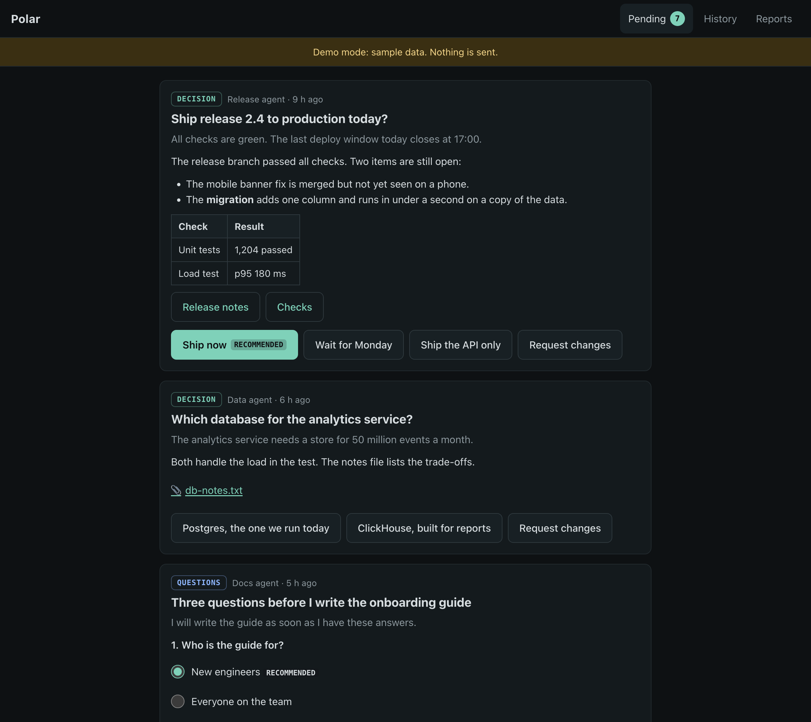
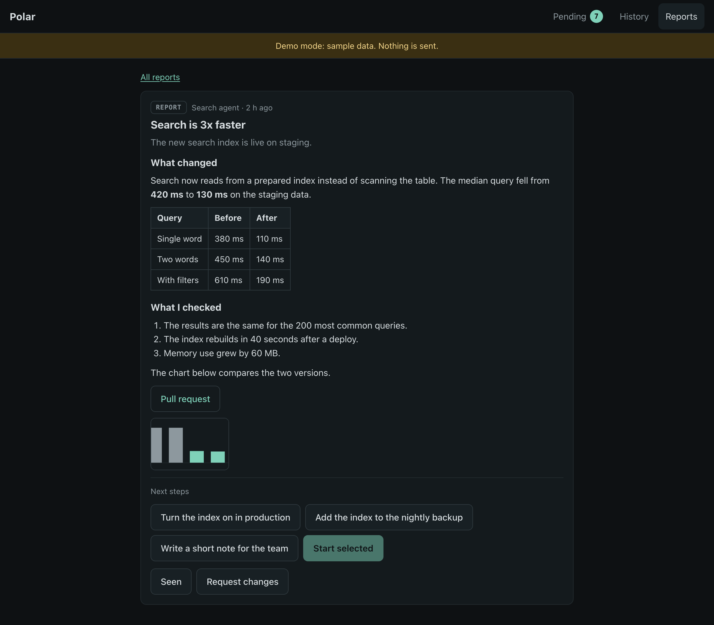
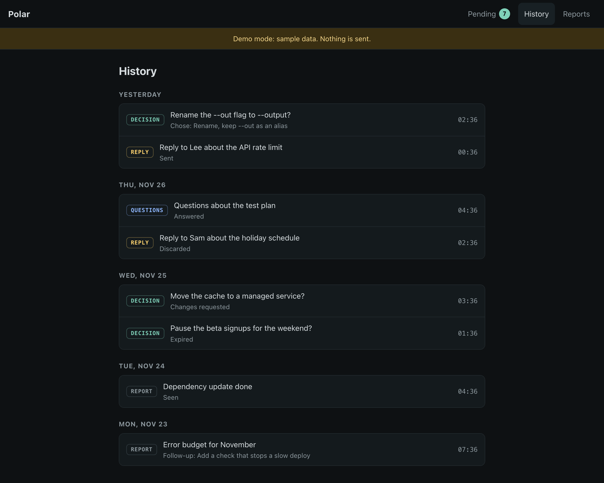

# Polar

Polar is a personal Slack approval app for AI coding agents.

An agent (for example a Claude Code session) often needs a human yes or no. It may need to
send a message as you, pick one option, or answer a few questions. Polar gives the agent one
CLI command for this. Polar then sends you a card in a Slack DM with buttons. Your click is
the approval.

The story behind it: [How I run a software factory of coding agents](https://crisorona.me/blog/software-factory.html).

## Try the demo

See the web UI on sample cards in one minute. No Slack app, no token and no config:

```sh
python3 -m venv .venv && .venv/bin/pip install -r requirements.txt
bin/polar demo                 # then open http://127.0.0.1:8792/
bin/polar demo --lang es --port 8793
```

The demo makes a new temporary folder each time, seeds it with invented cards and starts only the web UI.
The buttons work on that temporary database. Nothing goes to Slack or Gmail. Ctrl-C stops it and removes the folder.

## The problem

- An agent that runs in auto mode should not post to Slack as you. It has no way to prove
  that you read the text.
- Typing "ok" in a terminal is easy to miss. It is also hard to do from a phone.
- With Polar, the agent only queues a request. It never holds a token that can post as you.
  Polar posts the message with your user token, and only after you click Send.
  The click is the approval.

## What it does

1. The agent runs `polar ask ...`. The CLI writes one row in a local SQLite queue. It never calls Slack.
2. The Polar app (Socket Mode) reads the queue and DMs you a card.
3. You click a button. Only the configured owner's clicks count.
4. For a reply, Polar posts it to the target channel or thread with your user token.
5. Polar writes the outcome to SQLite. The agent reads it with `polar status <id>`. Polar can also type the outcome into the agent's session (see "Optional integrations").

```
agent -> polar CLI -> SQLite queue -> Polar app (Socket Mode)
                                          |
                                          v
                                   DM card (Block Kit)
                                          |  owner clicks
                                          v
                       post with user token  ->  outcome back to the agent
```

## Request kinds

| Kind | What the owner sees | What the click does |
| --- | --- | --- |
| `reply` | A draft message for a channel or thread. Buttons: Send, Edit, Discard, Request changes. | Send posts the text as the owner. Edit opens a modal first. |
| `decision` | A title, context and 2 to 4 options. | The chosen option goes back to the agent. |
| `questions` | 1 to 5 typed questions with options or free text. | The answers go back to the agent. |
| `email` | A Gmail draft reply, like `reply`. Needs a Gmail OAuth setup. | Send sends the mail in the same thread. |
| `report` | An FYI card: what a session did, with links, optional file and follow-up buttons. | No approval needed. Follow-up buttons start new work. |
| `agent` | A card that offers to open a new agent session for a message. | The owner starts the session. |

### Scheduled follow-ups

`polar report … --revisar "SPEC|what"` (repeat, max 3) asks the bus to hand `what` back to the session when SPEC is met
(`30-nov 10:00`, `mañana 9:00`, `+3d 9:00`, `prod:<repo>#<n>`, `ci:<repo>#<n>`). Polar checks every item
with `agent-bus followup add --dry-run` first and refuses the whole command with the bus's Spanish error (or «Falta la sesión.»
when `--requester` has no session id). Then it adds them, creates the card (list stored in `requests.followups_json`) and runs
`followup set-card`. The card shows «🗓 Revisaré …» lines with «Cancelar». Report cards and answered decision or questions
cards also have the owner select «🗓 Revisar después» (never on a card that waits, a reply or email card, a prod-op card, or a card
with no session id). The «prod» choice needs a PR link on the card; set `POLAR_GITHUB_ORG` to accept only PRs of one org.
`AGENT_BUS_BIN` overrides the bus path. Code: `polar/followups.py`.

Every approval card also has "Pedir cambios" (request changes). The owner types what to change.
The agent then queues a new card with `--replaces <id>`.

Polar also has these optional features. They are all in the code today. Read `docs/reference.md` for details.

- Tasks: the owner DMs Polar, and Polar starts a Claude Code session in tmux (or hands the task to a laptop relay).
- File handling: files in the owner's DMs are downloaded for the session.
- Web-first delivery and reminders: a local HTTP API records decisions from a web page. Polar can send reminder DMs instead of card DMs.
- Gmail: `polar mail ...` and the `email` card.

## Web UI

`polar serve` also starts a small web UI when `POLAR_UI_PORT` is set (for example `8790`). It has three pages:

- **Pending**: the cards that wait for you (decisions, questions, replies and emails), then the reports you have not
  seen. Each card has the same actions as in Slack: choose, answer, send, discard, request changes, next steps, seen.
  Pictures open in a photo viewer. `/?c=<id>` puts one card first.
- **History**: the decided cards, grouped by day, newest first.
- **Reports**: every report, with a search box. `/reports/<id>` (or `/informes/<id>`) is one full report.

Each button runs the same core method as the Slack button, in the same process, so the Slack card updates too.
Send stays off until you set `POLAR_WEB_ALLOW=send`. The page refreshes itself when a card changes, but not while you type.
The UI is in English or Spanish (`POLAR_UI_LANG=en|es`). It is server-rendered HTML with one small script and
one style sheet: no Node, no build step, no external assets. The only new dependency is `Markdown`.

The UI binds to 127.0.0.1 only. To open it from your phone, put a reverse proxy in front of it that you trust (for
example Tailscale Serve, or nginx with your own login):

- add the public host name to `POLAR_UI_HOSTS` (the UI refuses any other `Host` header), and
- set `POLAR_UI_OWNER` to your login and `POLAR_UI_OWNER_HEADER` to the header your proxy sets
  (default `Tailscale-User-Login`). The UI then refuses a request without that exact value.

Do not expose the port to a network without such a proxy. Set `POLAR_WEB_URL` to the URL you open, so Slack
reminders and report cards link to it.

## Screenshots







## Install

Requirements: Python 3.9 or newer, a Slack workspace where you can install an app.

1. Create the Slack app. In the Slack API site choose "Create New App", then "From a manifest", and paste `slack/manifest.yaml`.
2. Install the app to your workspace. Copy three tokens:
   - the bot token (`xoxb-...`),
   - the app-level token for Socket Mode (`xapp-...`, scope `connections:write`),
   - your user token (`xoxp-...`).
3. Store the tokens. Polar looks in this order: the macOS keychain, a private file, an environment variable.
   - Keychain: services `polar-bot-token`, `polar-app-token`, `polar-user-token` (account = `$USER`).
   - Files: `~/.config/polar/{bot,app,user}-token`. The folder must be mode 0700 and each file mode 0600. Polar ignores them otherwise.
   - Env: `POLAR_BOT_TOKEN`, `POLAR_APP_TOKEN`, `POLAR_USER_TOKEN`.
4. Install and run:

```sh
python3 -m venv .venv
.venv/bin/pip install -r requirements.txt
export POLAR_OWNER_ID=U0123456789        # your Slack user id
export POLAR_OWNER_DM=D0123456789        # your DM channel with the bot (needed for tasks and notices)
export POLAR_SLACK_URL=https://myteam.slack.com
bin/polar doctor                          # checks the three tokens
bin/polar serve
```

5. Queue a request from any shell on the same machine:

```sh
bin/polar ask decision --title "Deploy now?" --context "CI is green." \
  --option go:Go --option wait:Wait --requester "my-agent"
bin/polar status <id>
```

`deploy/` has an example macOS LaunchAgent and an `install.sh` that copies Polar to an always-on Mac over ssh.
Edit the plist first (label, owner id, URLs).

## Configuration

| Variable | Default | Meaning |
| --- | --- | --- |
| `POLAR_OWNER_ID` | placeholder | Slack user id. Only this user's clicks and DMs count. Set it. |
| `POLAR_OWNER_DM` | placeholder | The owner's DM channel with the bot. |
| `POLAR_SLACK_URL` | `https://example.slack.com` | Workspace URL, used to build message permalinks. |
| `POLAR_DATA_DIR` | `<repo>/data` | SQLite file, web token, downloaded files, Gmail files. |
| `POLAR_TOKEN_DIR` | `~/.config/polar` | Folder for token files. |
| `POLAR_BOT_TOKEN`, `POLAR_APP_TOKEN`, `POLAR_USER_TOKEN` | none | Token fallback. |
| `POLAR_TZ` | `UTC` | Time zone for reminder quiet hours. The web UI uses it for dates; unset, the UI uses the system zone. |
| `POLAR_DELIVERY` | `dm` | `web` stops the card DMs (a web page shows the cards instead). |
| `POLAR_SLACK_REMINDERS` | `on` | `off` stops the reminder DMs. |
| `POLAR_WEB_PORT` | `8791` | Local web API port, bound to 127.0.0.1. `0` turns it off. |
| `POLAR_WEB_ALLOW` | none | Comma list (`send`, `prod`) that enables gated web actions. |
| `POLAR_WEB_URL` | none | Base URL of your web page (the web UI URL). Adds a "full report" link to report cards and links in reminders. |
| `POLAR_UI_PORT` | none | Port of the web UI, bound to 127.0.0.1. Unset or `0`: the UI is off. |
| `POLAR_UI_HOSTS` | none | Comma list of extra `Host` values the UI accepts (the host name of your reverse proxy). |
| `POLAR_UI_OWNER` | none | When set, every UI request must carry this value in the owner header. |
| `POLAR_UI_OWNER_HEADER` | `Tailscale-User-Login` | The header that carries the login, set by your reverse proxy. |
| `POLAR_UI_LANG` | `en` | Language of the web UI: `en` or `es`. |
| `POLAR_TASK_MAX`, `POLAR_TASK_MIN_FREE_GB`, `POLAR_WORK_DIR` | see reference | Limits and folder for tmux task sessions. |
| `POLAR_CLAUDE_BIN`, `POLAR_CLAUDE_ARGS`, `POLAR_TMUX_BIN` | see reference | How task sessions start. |
| `POLAR_BIN` | `~/polar/bin/polar` | Path of the CLI as written in the task brief. |
| `POLAR_TASK_RULES` | empty | Extra rules text added to the brief of each task session, right after «no browser». Start it with `;` or `.`, or Polar adds `. `. |
| `POLAR_SERVER_NAME` | empty | Name of the always-on host. Owner texts say «en <name>» (else «en el servidor») and new tasks store it as host (else `server`). |
| `POLAR_COORD_TICK_LABEL` | `coord-tick` | launchd label that the coord-tick watchdog text tells the owner to kick. |
| `POLAR_MODEL_FULL_CMD` | empty | Command (for example `my-tool model-full`) that gets the model name `fable` as last argument and exits 0 when the weekly limit of that model is used up. Then new tasks start on `opus`. Unset: no check. |
| `POLAR_ALARM_BIN` | empty | Command for loud failures (a path, may include fixed arguments), for example `harness-alarm` from agent-harness. Polar runs `<bin> --key K --title T --text X` when a tick keeps failing (3 in 5 minutes), an approved send fails, a send is found interrupted at start, or the web API returns 500. Unset or missing binary: Polar only writes the alarm to the log. |
| `POLAR_DEFAULT_WHERE` | `server` | `laptop` makes the laptop the default task host. |
| `AGENT_TASK_MODEL` | `opus` | Model flag for task sessions. Empty means no flag. |

Canary card: `polar ask decision ... --canary` queues a test card for an end-to-end health check. It is stored with a `canary` marker in its extras, goes to no DM (Slack or otherwise) and is meant to be hidden by a web page. Only a decision can be a canary.

More variables (timeouts, triage, Gmail) are in `docs/reference.md` and the source.

## Security model

- Only `POLAR_OWNER_ID` can act. Clicks, modal submits, DMs and the web API all check this id.
- The agent never gets a Slack token. The CLI only writes SQLite.
- The user token posts only after a click on Send (or a web action that calls the same code).
- Polar does not print or log tokens. `polar doctor` shows team and user names only.
- Token files must be 0600 in a 0700 folder.
- The web API binds to 127.0.0.1, needs a bearer token (`data/web-token`, mode 0600), checks the `Host` header and limits the body size.
  Sending to other people and production steps from the web are off unless you set `POLAR_WEB_ALLOW`.
- The web UI binds to 127.0.0.1 and accepts only its own `Host` values (plus `POLAR_UI_HOSTS`). With `POLAR_UI_OWNER`
  set, it also needs the owner header from your proxy. Each POST needs a same-site `Origin` and a CSRF token (an
  HMAC from a per-install secret, `data/web-ui-secret`, mode 0600). Pages send a strict Content Security Policy with
  no inline script, and every value is escaped. The UI serves files only from `data/files` and `data/uploads`.
- A stale click on a card that is already decided does nothing.
- Polar never starts a session with `--dangerously-skip-permissions`.

Slack scopes in the manifest and why:

| Scope | Why |
| --- | --- |
| bot `chat:write`, `im:write` | Send you cards and notices. |
| bot `im:history`, `app_mentions:read` | Read your DMs and mentions (tasks). |
| bot `files:read`, `files:write` | Download your attachments. Upload files to a card thread. |
| user `chat:write` | Post your approved reply as you. |
| user history and read scopes, `search:read`, `users:read` | Read threads and channel names to quote context in a card. |
| user `files:read` | Download files of messages where the bot is not a member. |

Read `SECURITY.md` to report a problem.

## Limitations

- Slack card text, buttons and notices are in Spanish today. The web UI has English and Spanish.
- Single owner. There is no multi-user or multi-workspace mode.
- macOS first: the keychain lookup, the LaunchAgent and the free-memory check use macOS tools. Token files and env vars work elsewhere.
- Some code is tied to the author's setup (see below). It works without that setup, but the names are still in the code.
- The tasks feature needs `tmux` and the `claude` CLI. It is optional.
- Slack user tokens have broad access. Protect the machine that runs Polar.
- The test suite uses fake Slack clients. There is no end-to-end test against real Slack.

## Optional integrations (examples)

Polar was built next to a private agent harness. These pieces are optional. Without them, Polar works as described above.

- Requester strings such as `prod-op ...` and `release-desk` change how Polar routes an outcome and gate the web `prod` action.
- `agent-bus` (binary path in `AGENT_BUS_BIN`) delivers text to parked sessions. `herdr-deliver` is used for tmux sessions. `polar-notify` is the relay that types outcomes into sessions.
- A heartbeat watchdog reads `POLAR_COORD_HEARTBEAT`. It stays quiet when the file is missing.

Treat these as examples. Replace them with your own relay.

## Tests

```sh
python3 -m venv .venv && .venv/bin/pip install -r requirements-dev.txt
.venv/bin/python3 -m pytest
```

Tests use no network.

## License

MIT. See `LICENSE`. Author: Cris Orona.
